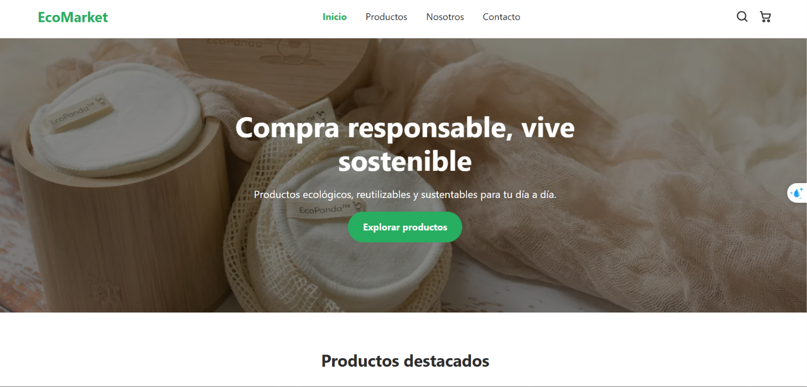
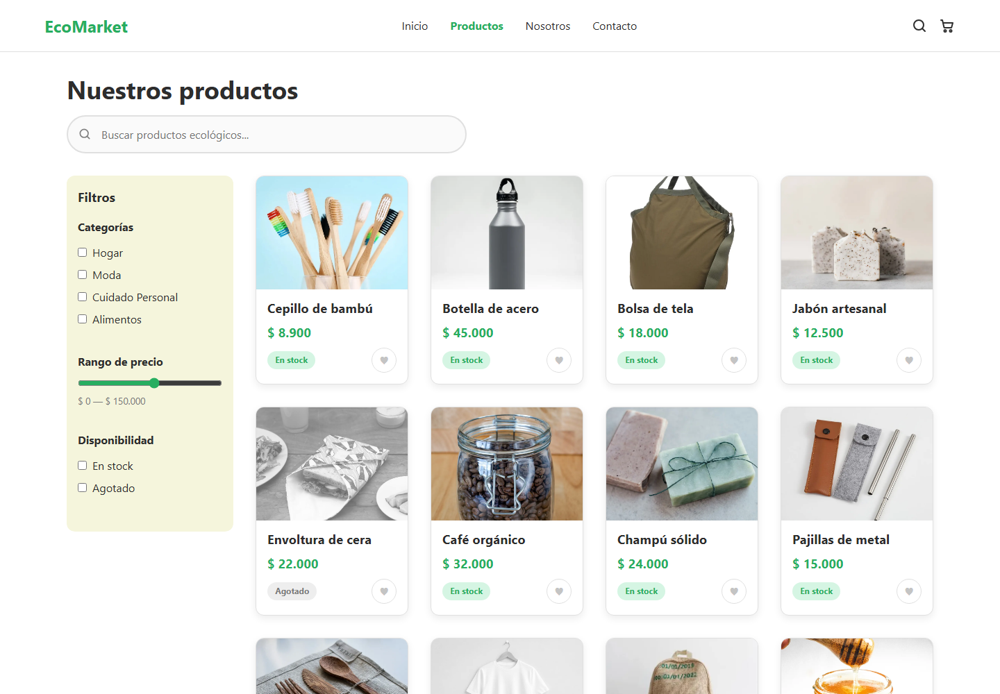
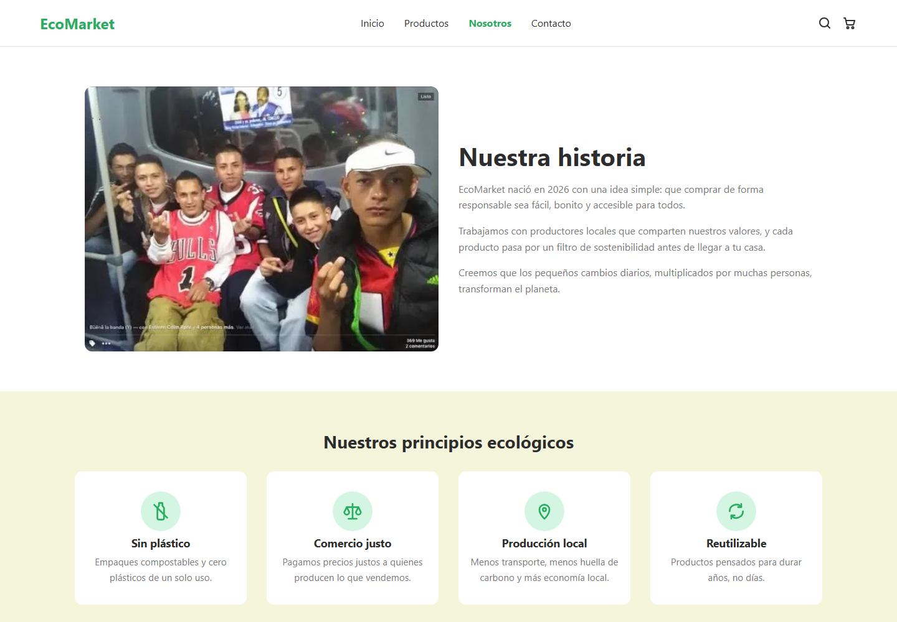
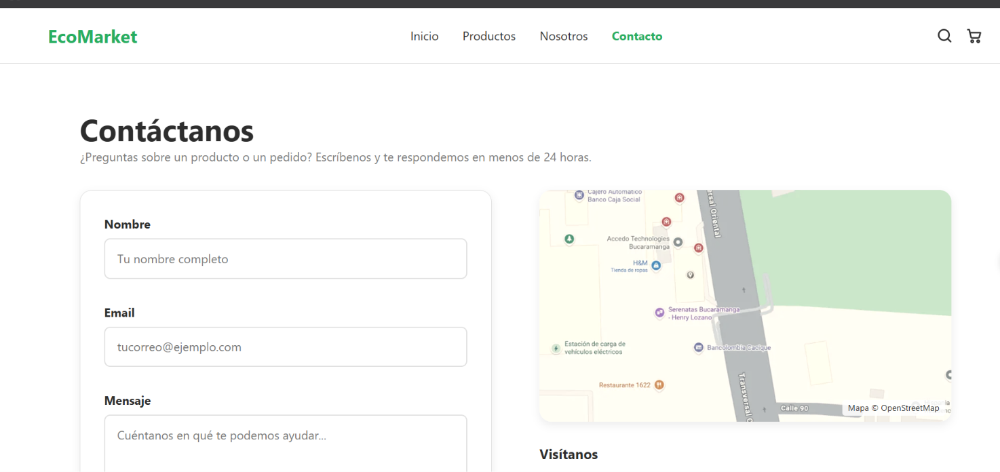
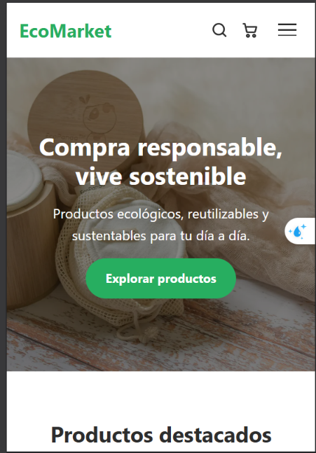
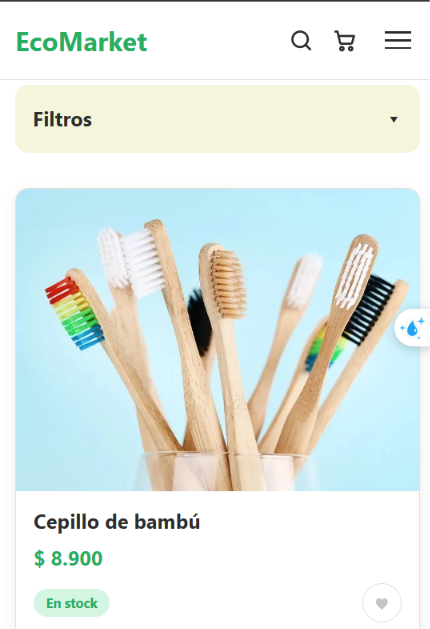
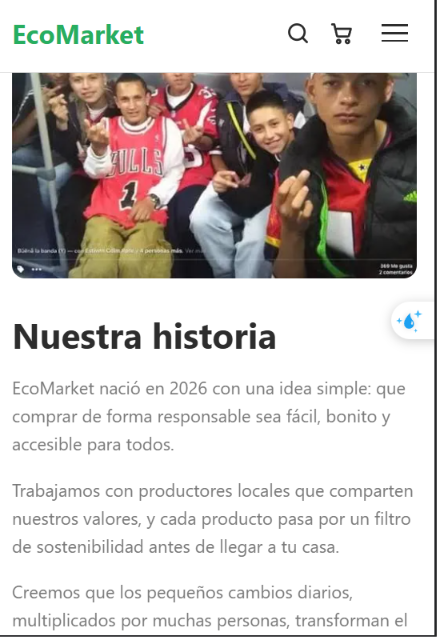
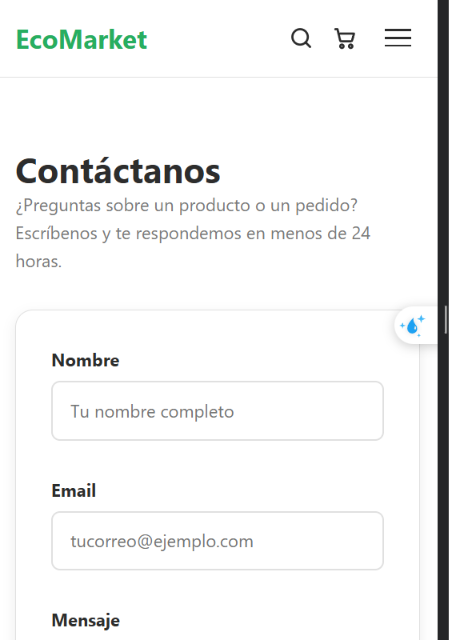

# EcoMarket

Tienda en línea de productos, maquetada solo con HTML5 semántico y CSS3 puro. No usa JavaScript ni frameworks: toda la interactividad (menú, filtros, favoritos, carrusel y validación de formularios) está resuelta con CSS.

🔗 **Sitio publicado:** https://judatasgar.github.io/EcoMarket_JDANIEL_TAPIAS/

---

## Vistas

| Vista | Archivo | Qué incluye |
|---|---|---|
| **Inicio** | `index.html` | Header con menú hamburguesa, hero a ancho completo con CTA, 6 productos destacados con efecto *hover*, footer |
| **Productos** | `views/productos.html` | Buscador visual, sidebar de filtros *sticky*, grid de 20 productos (1 → 2 → 4 columnas), etiquetas de stock, botón de favoritos, paginación |
| **Sobre Nosotros** | `views/sobre-nosotros.html` | Historia con Flexbox, principios ecológicos con íconos, carrusel de testimonios |
| **Contacto** | `views/contacto.html` | Formulario con validación visual (verde/rojo), mapa estilizado, redes sociales con animación `scale` |

## Tecnologías

- **HTML5 semántico:** `header`, `nav`, `main`, `section`, `article`, `aside`, `footer`, `address`, `figure`, `blockquote`, `fieldset`
- **CSS3 puro:** Flexbox, CSS Grid, variables (`:root`), media queries, transiciones, `scroll-snap`
- **Íconos SVG propios**, sin librerías externas
- **Git** con GitFlow y **GitHub Pages** para el despliegue

## Interactividad sin JavaScript

| Funcionalidad | Técnica CSS |
|---|---|
| Menú hamburguesa en móvil | `input[type="checkbox"]` oculto + `<label>` + `:checked ~ .nav` |
| Filtros plegables en móvil | El mismo patrón `:checked ~` |
| Sidebar que acompaña el scroll | `position: sticky` |
| Botón de favoritos | `:target` (el `id` de la tarjeta coincide con el `#` de la URL) y `:active` |
| Carrusel de testimonios | `overflow-x: auto` + `scroll-snap-type` + enlaces `#testimonio-n` |
| Validación del formulario | `:valid`, `:invalid`, `:placeholder-shown` y `:user-invalid` |
| Tarjetas que se elevan | `:hover` + `transform: translateY()` + `transition` |
| Redes sociales | `:hover` + `transform: scale()` |

## Decisiones de diseño

- **Mobile First:** el CSS base es el de móvil, y se amplía con `@media (min-width: 768px)` (tablet), `1024px` y `1280px` (escritorio).
- **Paleta natural:** verdes `#2ecc71` y `#27ae60`, beige `#f5f5dc`, definidos como variables en `css/main.css`.
- **Tipografía del sistema** (`system-ui`): legible, accesible y sin descargas externas.
- **Clases con BEM en español:** `.tarjeta__titulo`, `.etiqueta--agotado`, etc.
- **Accesibilidad:** textos `alt`, `aria-label` en los íconos, `label` en cada campo y respeto a `prefers-reduced-motion`.
- **Rendimiento:** imágenes en `.webp` optimizadas y `loading="lazy"` en el catálogo.

## Estructura

```
EcoMarket_JDANIEL_TAPIAS/
├── css/
│   ├── main.css          # Reset, variables y tipografía
│   ├── layout.css        # Header, footer y grids de cada sección
│   ├── components.css    # Tarjetas, botones, formulario, filtros
│   └── animations.css    # Transiciones y efectos hover
├── img/
│   ├── products/         # Fotos de productos (.webp)
│   ├── icons/            # Íconos SVG
│   └── hero/             # Banner, historia, mapa y clientes
├── views/
│   ├── productos.html
│   ├── sobre-nosotros.html
│   └── contacto.html
├── capturas/             # Imágenes de este README
├── index.html
└── README.md
```

## Cómo visualizarlo

**En línea:** abre https://judatasgar.github.io/EcoMarket_JDANIEL_TAPIAS/

**En tu computador:**

1. Clona el repositorio:
   ```bash
   git clone https://github.com/judatasgar/EcoMarket_JDANIEL_TAPIAS.git
   ```
2. Abre la carpeta en VS Code.
3. Clic derecho sobre `index.html` → **Open with Live Server**. También puedes abrir el archivo directamente en el navegador.

Para probar la versión móvil: `F12` → ícono de dispositivo (o `Ctrl + Shift + M`).

## Capturas

### Escritorio

| Inicio | Productos |
|---|---|
|  |  |

| Sobre Nosotros | Contacto |
|---|---|
|  |  |

### Móvil

| Inicio | Productos | Sobre Nosotros | Contacto |
|---|---|---|---|
|  |  |  |  |

## Wireframes

Antes de programar, el diseño se planeó con wireframes en Figma, en versión móvil (375 px) y escritorio (1440 px). Están en la carpeta [`capturas/wireframes/`](capturas/wireframes/).

## Flujo de trabajo con Git

Se usó **GitFlow**: cada sección se desarrolló en su propia rama `feature/`, se unió a `develop` y después a `main`, que es la rama publicada. Los commits siguen **Conventional Commits** (`feat:`, `fix:`, `docs:`, `chore:`).

```
main  ←  develop  ←  feature/estructura-base
                  ←  feature/home_appliances
                  ←  feature/catalogo
                  ←  feature/sobre-nosotros
                  ←  feature/contact-form
                  ←  feature/readme-deploy
```
## Autor

**J. Daniel Tapias** · [@judatasgar](https://github.com/judatasgar)
Proyecto del Técnico en Desarrollo de Software — Campuslands, 2026.
